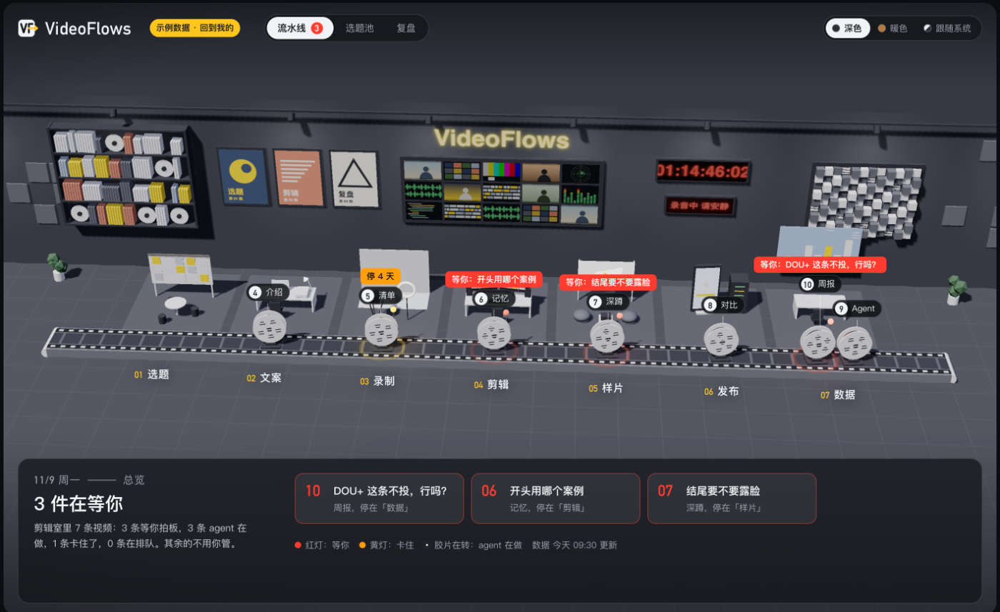
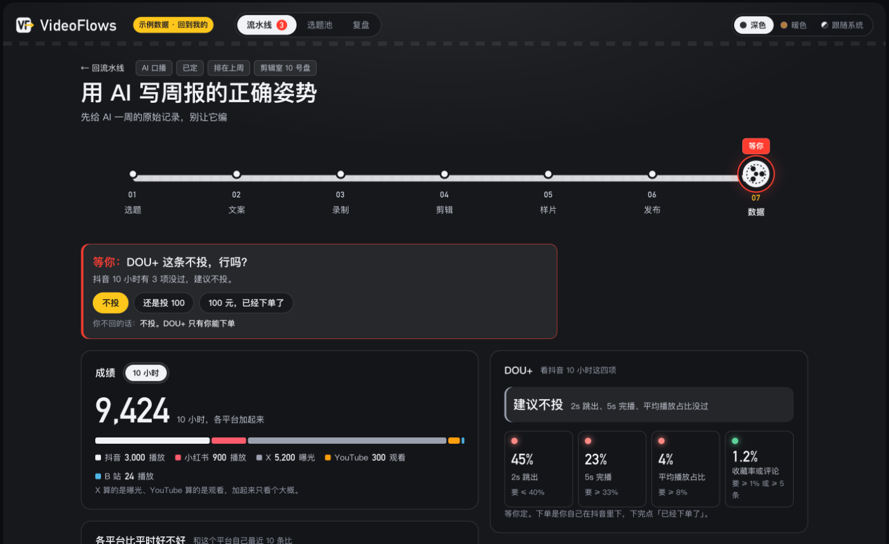
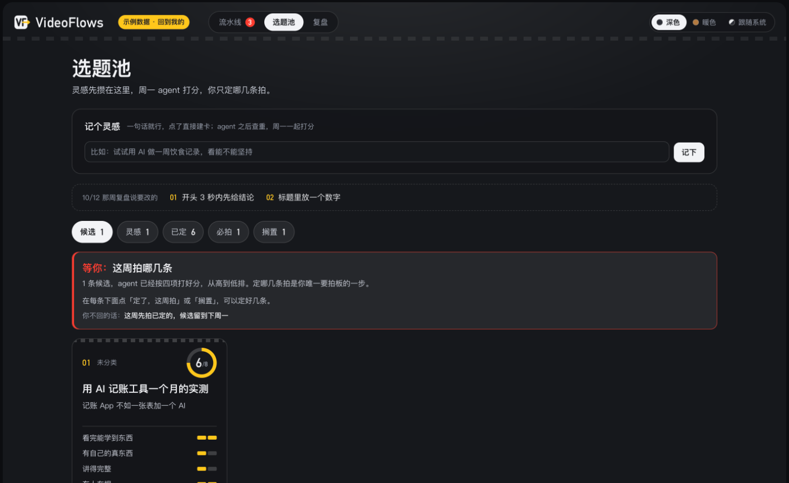
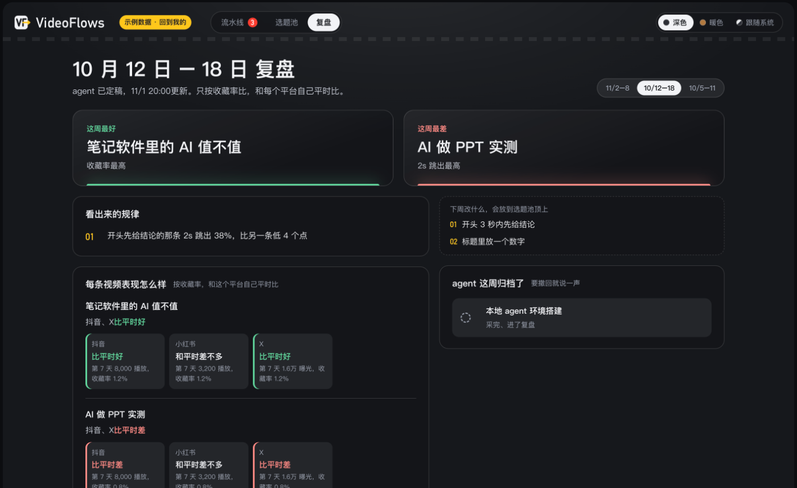

# VideoFlows

[中文](#中文) · [English](#english)

## 中文

VideoFlows 是一套从选题到数据复盘的自媒体流水线看板。每条视频是一张「卡」（一个 JSON 文件），依次走过选题、文案、录制、剪辑、样片关卡、发布、数据和周复盘。脚本把所有卡算成索引，静态页面「剪辑室」用 3D 传送带显示每条视频走到哪、哪里卡住、哪里在等你拍板。

- 数据就是仓库里的文件，人和 AI agent 都能改，每次改动都有 git 记录
- 校验严格：字段、阶段流转、采样指标有错就停下，不生成半份结果
- 零依赖：只要 Node.js 18+ 和 git，不用 `npm install`
- 可选部署到 Cloudflare Pages，用 Zero Trust 登录保护，网页按钮可直接写回 GitHub

模板不带任何真实数据：`cards/`、`reviews/` 是空的，`tests/fixtures/board/` 里全是假数据。

### 截图

下面都是 `?demo` 示例数据。



| 视频详情 | 选题池 | 周复盘 |
| --- | --- | --- |
|  |  |  |

### 本地运行

```bash
node scripts/build-site.mjs
python3 -m http.server 3000 -d dist   # 或任意静态服务器，比如 npx serve dist
```

打开 `http://localhost:3000/` 看空看板；地址后加 `?demo` 看示例数据（`http://localhost:3000/?demo`）。

```bash
node scripts/build-index.mjs   # 校验数据并生成 index.json、index.archive.json
node tests/run.mjs             # 跑全部验收测试
node scripts/now.mjs           # 打印配置时区下的当前时间，加 --week 打印 ISO 周
```

也可以用 `npm run build`（生成网站）、`npm run check`（只校验）、`npm test`。

`build-index` 的常用参数：`--check` 只校验不写文件；`--now <时间>` 固定「现在」；`--root <目录>` 换数据目录；`--no-git` 跳过阶段流转检查。

### 接自己的数据

1. 改 `config.json`：时区 `timezone`（默认 `Asia/Shanghai`）、平台、采样点、四道筛的打分标准、DOU+ 阈值。阈值和打分标准都是示例默认值，请按自己的账号调整。
2. 在 `cards/active/` 新建卡，文件名是 `<日期>-<英文短名>.json`。模板和字段规则见 [AGENTS.md](AGENTS.md) 第 3、5 节，完整定义见 [schema/](schema/)。
3. 周复盘放在 `reviews/<年>-W<周>.json`。
4. 平台后台怎么读数，见 [adapters/](adapters/README.md)。各平台菜单位置按公开资料写成，没有实际登录核对，第一次使用时请校正。
5. 跑 `node scripts/build-index.mjs`，修到通过后提交。

内容类型（`ai_talk` 口播、`fitness` 健身、`other` 其他）和 5 个平台 id 是 schema 里的固定选项，光改 `config.json` 换不了。要换的话，改 `schema/*.schema.json` 里对应的枚举，再改 `site/app.js` 的 `KIND_NAME`（类型名）和 `PLAY_CN`（平台名）；加平台还要在 `adapters/` 下加一份说明。

用 AI agent 维护时，让它先读 [AGENTS.md](AGENTS.md)，里面写了哪些字段只有你能拍板、哪些操作禁止。

### 部署到 Cloudflare Pages

1. 把仓库放到自己的 GitHub 账号，并设为**私有**：卡里会有你的真实数据。不要直接 Fork，公开仓库的 Fork 不能改成私有。点仓库页的 Use this template 新建一个私有仓库；或者 clone 下来，推到你自己新建的私有仓库。
2. Cloudflare → Workers & Pages → 创建 Pages 项目，连接仓库：

   | 设置 | 值 |
   | --- | --- |
   | 生产分支 | `main` |
   | 框架预设 | None |
   | 构建命令 | `node scripts/build-site.mjs` |
   | 输出目录 | `dist` |

   仓库的 `.node-version` 固定 Node 22。每次 push 到 `main` 自动重新生成。

**Zero Trust 登录**：第一次用 Cloudflare Zero Trust 要先建一个团队，团队名就是后面 `ACCESS_TEAM_DOMAIN` 里的 `<your-team>`。再在 Zero Trust 的登录方式设置（Authentication / Login methods）里添加 One-time PIN。各菜单名以 Cloudflare 控制台当前版本为准。然后在 Access → Applications 新建 Self-hosted 应用：

- 域名填 `<your-project>.pages.dev` 和 `*.<your-project>.pages.dev`（后者保护预览地址）
- 策略选 Allow，规则 Emails 填 `<you@example.com>`
- 登录方式选 One-time PIN

看板会展示你的全部数据，请在写入真实数据前配好。`site/_headers` 和 `robots.txt` 只是禁止搜索引擎收录，不能代替登录保护。

**网页按钮回写（`GITHUB_TOKEN`）**：`functions/api/act.js` 会被自动部署成 `/api/act`。它验证 Access 登录凭证后，把按钮操作提交回仓库，提交信息是 `[web] <动作>: <卡 id>`。不配置时看板只读，点按钮会提示还没开通。

先在 GitHub → Settings → Developer settings → Personal access tokens → Fine-grained tokens 新建令牌：Repository access 只选这个仓库，Permissions 只开 Contents: Read and write，并设过期时间。再到 Pages 项目 → Settings → Variables and Secrets 添加：

| 变量 | 值 | 必填 |
| --- | --- | --- |
| `GITHUB_TOKEN` | 上面的令牌，类型选 Secret | 是 |
| `GITHUB_REPO` | `<owner>/<repo>` | 是 |
| `ACCESS_TEAM_DOMAIN` | `<your-team>.cloudflareaccess.com` | 是 |
| `ACCESS_AUD` | Access 应用 Overview 里的 Application Audience (AUD) Tag | 是 |
| `ALLOWED_EMAILS` | 逗号分隔的邮箱，如 `<you@example.com>`；只有这些账号能写，没设就拒收 | 是 |
| `GITHUB_BRANCH` | 默认 `main` | 否 |

变量设在 Production 环境；想让预览地址也能写，Preview 环境也要设一份。改完变量要重新部署一次才生效。不要把令牌写进仓库。

如果给 `main` 开了分支保护（比如要求走 PR），网页按钮会写不进去：要么不开，要么把 `GITHUB_BRANCH` 设成一个不受保护的分支。

### 目录

```
AGENTS.md       给 agent 的写入规则
config.json     平台、采样点、阈值等配置
cards/          活跃卡（active/）和归档卡（archive/<年>/）
reviews/        周复盘
schema/         card / review / config / adapter 的 JSON Schema
adapters/       各平台的只读采集说明
scripts/        build-index、build-site 等脚本，规则都在这里
functions/api/  Cloudflare Pages 服务器函数
site/           静态页面，vendor/three 是 three.js（MIT）
tests/          验收测试、假数据、schema 样例
docs/           README 用的截图
```

### 许可证

[MIT](LICENSE)。`site/vendor/three/` 是 three.js，保留其自身的许可证。

---

## English

VideoFlows is a content-pipeline board for solo creators, covering everything from topic selection to post-publish review. Each video is a "card" (one JSON file) that moves through topic, script, recording, editing, a sample gate, publishing, metrics and a weekly review. A script compiles the cards into an index, and a static page, the "edit room", renders a 3D conveyor belt showing where each video is, what is stuck and what needs your decision.

- Your data is plain files in the repo. People and AI agents can both edit it, and git records every change.
- Validation is strict: a bad field, stage transition or metric stops the build, so you never get half an index.
- Zero dependencies: Node.js 18+ and git. No `npm install`.
- Optional Cloudflare Pages deployment with Zero Trust login, and buttons that write back to GitHub.

The template ships with no real data: `cards/` and `reviews/` are empty, and everything in `tests/fixtures/board/` is made up. The UI and most docs are in Chinese.

### Screenshots

All screenshots use the `?demo` sample data.


| Video detail | Topic pool | Weekly review |
| --- | --- | --- |
|  |  |  |

### Run locally

```bash
node scripts/build-site.mjs
python3 -m http.server 3000 -d dist   # or any static file server, such as npx serve dist
```

Open `http://localhost:3000/` for an empty board, or add `?demo` for sample data (`http://localhost:3000/?demo`).

```bash
node scripts/build-index.mjs   # validate data, write index.json and index.archive.json
node tests/run.mjs             # run all acceptance tests
node scripts/now.mjs           # current time in the configured timezone; --week prints the ISO week
```

`npm run build` (build the site), `npm run check` (validate only) and `npm test` do the same.

Useful `build-index` flags: `--check` validates without writing, `--now <time>` pins the clock, `--root <dir>` uses another data directory, and `--no-git` skips stage-transition checks.

### Use your own data

1. Edit `config.json`: `timezone` (default `Asia/Shanghai`), platforms, sample points, scoring criteria and DOU+ thresholds. The thresholds and criteria are sample defaults, so tune them for your account.
2. Add cards to `cards/active/`, named `<date>-<slug>.json`. See sections 3 and 5 of [AGENTS.md](AGENTS.md) for the template and field rules, and [schema/](schema/) for full definitions.
3. Put weekly reviews in `reviews/<year>-W<week>.json`.
4. See [adapters/](adapters/README.md) for how to read each platform's dashboard. The menu locations come from public documentation and have not been checked against live accounts, so correct them on first use.
5. Run `node scripts/build-index.mjs`, fix anything it reports, then commit.

Content types (`ai_talk` talking-head, `fitness`, `other`) and the five platform ids are fixed enums in the schemas, so `config.json` alone cannot change them. To change them, edit the enums in `schema/*.schema.json`, then `KIND_NAME` (type labels) and `PLAY_CN` (platform labels) in `site/app.js`. A new platform also needs its own notes under `adapters/`.

If an AI agent maintains the board, have it read [AGENTS.md](AGENTS.md) first. It lists which fields only you may decide and which actions are forbidden.

### Deploy to Cloudflare Pages

1. Put the repo on your own GitHub account and make it **private**, because your cards will hold real data. Do not fork it: a fork of a public repo cannot be made private. Click Use this template on the repo page to create a private copy, or clone it and push to a new private repo of your own.
2. In Cloudflare → Workers & Pages, create a Pages project connected to the repo:

   | Setting | Value |
   | --- | --- |
   | Production branch | `main` |
   | Framework preset | None |
   | Build command | `node scripts/build-site.mjs` |
   | Output directory | `dist` |

   `.node-version` pins Node 22. Every push to `main` rebuilds the site.

**Zero Trust login**: the first time you use Cloudflare Zero Trust, create a team. The team name is the `<your-team>` part of `ACCESS_TEAM_DOMAIN` below. Then add One-time PIN in the Zero Trust login method settings (Authentication / Login methods). Menu names may differ in the current Cloudflare dashboard. Finally, add a Self-hosted application under Access → Applications:

- Domains: `<your-project>.pages.dev` and `*.<your-project>.pages.dev` (the second covers preview URLs)
- Policy: Allow, with an Emails rule set to `<you@example.com>`
- Login method: One-time PIN

The board exposes all of your data, so set this up before adding real data. `site/_headers` and `robots.txt` only ask search engines not to index the site. They do not replace login.

**Write-back buttons (`GITHUB_TOKEN`)**: `functions/api/act.js` deploys automatically as `/api/act`. After verifying the Access token, it commits each button action to the repo as `[web] <action>: <card id>`. Without this configuration the board is read-only and the buttons say so.

Create a token at GitHub → Settings → Developer settings → Personal access tokens → Fine-grained tokens. Limit repository access to this repo, grant only Contents: Read and write, and set an expiry. Then add these in the Pages project under Settings → Variables and Secrets:

| Variable | Value | Required |
| --- | --- | --- |
| `GITHUB_TOKEN` | The token above, stored as a Secret | Yes |
| `GITHUB_REPO` | `<owner>/<repo>` | Yes |
| `ACCESS_TEAM_DOMAIN` | `<your-team>.cloudflareaccess.com` | Yes |
| `ACCESS_AUD` | The Application Audience (AUD) Tag from the Access application's Overview | Yes |
| `ALLOWED_EMAILS` | Comma-separated emails such as `<you@example.com>`; only these accounts can write, and writes are refused when it is unset | Yes |
| `GITHUB_BRANCH` | Defaults to `main` | No |

Set the variables for the Production environment, and for Preview too if preview URLs should be able to write. Redeploy after changing variables. Never commit the token.

If `main` has branch protection (for example, requiring pull requests), the buttons cannot write. Either leave it off or point `GITHUB_BRANCH` at an unprotected branch.

### Layout

```
AGENTS.md       write rules for agents
config.json     platforms, sample points, thresholds
cards/          active cards (active/) and archived cards (archive/<year>/)
reviews/        weekly reviews
schema/         JSON Schemas for card, review, config and adapter
adapters/       read-only collection notes per platform
scripts/        build-index, build-site and friends; all rules live here
functions/api/  Cloudflare Pages function
site/           static page; vendor/three is three.js (MIT)
tests/          acceptance tests, fake data, schema samples
docs/           screenshots for this README
```

### License

[MIT](LICENSE). `site/vendor/three/` is three.js and keeps its own license.
